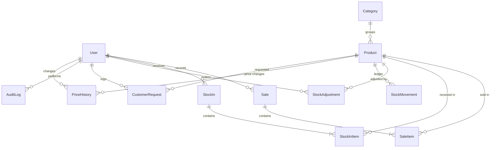

# Database Model

**Product:** Joy Palma Imports — Inventory & Sales Intelligence System
**Database:** PostgreSQL 15+ · **ORM:** Prisma
**Document version:** 1.0

---

## 1. Design principles

1. **Money as integers.** All money columns are `Int` in **pesewas** (1 GHS = 100 pesewas). `₵12.50` is stored as `1250`. No floats, ever.
2. **Snapshots on transactions.** Each sale line stores the unit price *and* unit cost at the time of sale. Changing a product's price never changes history.
3. **Stock is derived, then cached.** `Product.quantityInStock` is a cached value updated inside the same database transaction as every stock movement. The `StockMovement` ledger is the source of truth and can rebuild the cached value at any time.
4. **Soft state, not deletes.** Sales are voided, products archived, users deactivated.
5. **UTC timestamps.** All `DateTime` values in UTC; the UI converts to `Africa/Accra` (setting).
6. **Everything audited.** Mutations write an `AuditLog` row.
7. **IDs:** `cuid()` strings. Human-friendly numbers (receipt no., SKU) are separate unique columns.

## 2. Entity-relationship diagram



## 3. Enums

| Enum | Values |
|---|---|
| `Role` | `OWNER`, `MANAGER`, `SALES`, `VIEWER` |
| `UnitOfMeasure` | `PIECE`, `PACK`, `CARTON`, `DOZEN`, `KG`, `LITRE`, `METRE`, `SET`, `PAIR` |
| `PaymentMethod` | `CASH`, `MOBILE_MONEY`, `BANK_TRANSFER`, `CARD`, `OTHER` |
| `SaleStatus` | `COMPLETED`, `VOIDED` |
| `MovementType` | `STOCK_IN`, `SALE`, `SALE_VOID`, `ADJUSTMENT` |
| `AdjustmentReason` | `DAMAGED`, `LOST`, `THEFT`, `EXPIRED`, `RECOUNT`, `RETURNED_BY_CUSTOMER`, `OTHER` |
| `RequestStatus` | `OPEN`, `FULFILLED`, `DISMISSED` |
| `AuditAction` | `CREATE`, `UPDATE`, `ARCHIVE`, `RESTORE`, `VOID`, `LOGIN`, `LOGIN_FAILED`, `PASSWORD_RESET`, `DEACTIVATE` |

## 4. Tables

### 4.1 `User`
| Column | Type | Notes |
|---|---|---|
| id | String (cuid) | PK |
| name | String | |
| email | String | unique, lower-cased |
| passwordHash | String | bcrypt/argon2 |
| role | Role | default `SALES` |
| isActive | Boolean | default `true`; inactive users cannot log in |
| mustChangePassword | Boolean | default `true` for new users / after reset |
| lastLoginAt | DateTime? | |
| createdAt / updatedAt | DateTime | |

### 4.2 `Category`
| Column | Type | Notes |
|---|---|---|
| id | String | PK |
| name | String | unique |
| description | String? | |
| isActive | Boolean | default `true` |
| createdAt / updatedAt | DateTime | |

### 4.3 `Product`
| Column | Type | Notes |
|---|---|---|
| id | String | PK |
| sku | String | unique, auto `JPI-00001`, editable by Owner/Manager |
| name | String | indexed |
| description | String? | |
| categoryId | String? | FK → Category |
| unit | UnitOfMeasure | default `PIECE` |
| sellingPrice | Int | pesewas per unit; only Owner can change |
| costPrice | Int | pesewas per unit; latest/average landed cost |
| quantityInStock | Int | cached; ≥ 0 (CHECK constraint); never edited directly |
| lowStockThreshold | Int? | null → use business default |
| imageUrl | String? | |
| isArchived | Boolean | default `false` |
| createdById | String | FK → User |
| createdAt / updatedAt | DateTime | |

Indexes: `(isArchived, name)`, `(categoryId)`.

### 4.4 `PriceHistory`
| Column | Type | Notes |
|---|---|---|
| id | String | PK |
| productId | String | FK → Product |
| oldSellingPrice / newSellingPrice | Int | |
| oldCostPrice / newCostPrice | Int | |
| changedById | String | FK → User |
| changedAt | DateTime | default now |
| note | String? | |

### 4.5 `StockIn` (a shipment / delivery received)
| Column | Type | Notes |
|---|---|---|
| id | String | PK |
| reference | String | unique, auto `SI-2026-0001` |
| receivedAt | DateTime | default now; may be back-dated |
| supplier | String? | |
| note | String? | |
| totalCost | Int | sum of lines (pesewas), computed |
| receivedById | String | FK → User |
| createdAt | DateTime | |

### 4.6 `StockInItem`
| Column | Type | Notes |
|---|---|---|
| id | String | PK |
| stockInId | String | FK → StockIn (cascade) |
| productId | String | FK → Product |
| quantity | Int | > 0 |
| unitCost | Int | pesewas |
| lineCost | Int | quantity × unitCost |

### 4.7 `Sale`
| Column | Type | Notes |
|---|---|---|
| id | String | PK |
| receiptNumber | String | unique, auto `R-2026-000001` |
| soldAt | DateTime | default now; only Owner/Manager may back-date |
| status | SaleStatus | default `COMPLETED` |
| subtotal | Int | Σ lineTotal |
| discount | Int | default 0; Owner/Manager only; ≤ subtotal |
| total | Int | subtotal − discount |
| totalCost | Int | Σ lineCost (for profit) |
| paymentMethod | PaymentMethod | default `CASH` |
| customerName | String? | |
| customerPhone | String? | |
| note | String? | |
| soldById | String | FK → User |
| voidedAt | DateTime? | |
| voidedById | String? | FK → User |
| voidReason | String? | required when voided |
| createdAt / updatedAt | DateTime | |

Indexes: `(soldAt)`, `(status, soldAt)`, `(soldById, soldAt)`.

### 4.8 `SaleItem`
| Column | Type | Notes |
|---|---|---|
| id | String | PK |
| saleId | String | FK → Sale (cascade) |
| productId | String | FK → Product |
| productName | String | snapshot (so receipts stay readable if renamed) |
| quantity | Int | > 0 |
| unitPrice | Int | **snapshot** of Product.sellingPrice at sale time |
| unitCost | Int | **snapshot** of Product.costPrice at sale time |
| lineTotal | Int | quantity × unitPrice |
| lineCost | Int | quantity × unitCost |

Index: `(productId)`.

### 4.9 `StockAdjustment`
| Column | Type | Notes |
|---|---|---|
| id | String | PK |
| productId | String | FK → Product |
| quantityChange | Int | positive or negative, ≠ 0 |
| reason | AdjustmentReason | |
| note | String? | required when reason = `OTHER` |
| adjustedById | String | FK → User |
| adjustedAt | DateTime | default now |

### 4.10 `StockMovement` (ledger — source of truth for stock)
| Column | Type | Notes |
|---|---|---|
| id | String | PK |
| productId | String | FK → Product |
| type | MovementType | |
| quantityChange | Int | + for in, − for out |
| balanceAfter | Int | stock after this movement |
| referenceId | String | id of StockIn / Sale / StockAdjustment |
| occurredAt | DateTime | |
| userId | String | FK → User |

Index: `(productId, occurredAt)`.

### 4.11 `CustomerRequest` (unmet demand)
| Column | Type | Notes |
|---|---|---|
| id | String | PK |
| productId | String? | FK → Product, if it's an existing (out-of-stock) product |
| itemName | String | free text; copied from product name when productId set |
| quantityWanted | Int? | |
| note | String? | |
| status | RequestStatus | default `OPEN` |
| requestedAt | DateTime | default now |
| loggedById | String | FK → User |

Index: `(itemName)`, `(productId)`, `(requestedAt)`.

### 4.12 `AuditLog`
| Column | Type | Notes |
|---|---|---|
| id | String | PK |
| userId | String? | FK → User (null for failed login with unknown email) |
| action | AuditAction | |
| entityType | String | e.g. `Product`, `Sale` |
| entityId | String? | |
| before | Json? | |
| after | Json? | |
| ipAddress | String? | |
| createdAt | DateTime | |

Index: `(entityType, entityId)`, `(createdAt)`.

### 4.13 `Setting` (single row)
| Column | Type | Notes |
|---|---|---|
| id | Int | PK, always 1 |
| businessName | String | default "Joy Palma Imports Limited" |
| logoUrl | String? | |
| address / phone / email | String? | for receipts |
| currencyCode | String | default `GHS` |
| currencySymbol | String | default `₵` |
| timeZone | String | default `Africa/Accra` |
| defaultLowStockThreshold | Int | default 5 |
| receiptFooter | String? | |
| updatedAt | DateTime | |

### 4.14 `Counter` (for human-friendly sequential numbers)
| Column | Type | Notes |
|---|---|---|
| key | String | PK, e.g. `receipt:2026`, `stockin:2026`, `sku` |
| value | Int | incremented inside the transaction |

## 5. Prisma schema

```prisma
generator client {
  provider = "prisma-client-js"
}

datasource db {
  provider  = "postgresql"
  url       = env("DATABASE_URL")
  directUrl = env("DIRECT_URL")
}

enum Role {
  OWNER
  MANAGER
  SALES
  VIEWER
}

enum UnitOfMeasure {
  PIECE
  PACK
  CARTON
  DOZEN
  KG
  LITRE
  METRE
  SET
  PAIR
}

enum PaymentMethod {
  CASH
  MOBILE_MONEY
  BANK_TRANSFER
  CARD
  OTHER
}

enum SaleStatus {
  COMPLETED
  VOIDED
}

enum MovementType {
  STOCK_IN
  SALE
  SALE_VOID
  ADJUSTMENT
}

enum AdjustmentReason {
  DAMAGED
  LOST
  THEFT
  EXPIRED
  RECOUNT
  RETURNED_BY_CUSTOMER
  OTHER
}

enum RequestStatus {
  OPEN
  FULFILLED
  DISMISSED
}

enum AuditAction {
  CREATE
  UPDATE
  ARCHIVE
  RESTORE
  VOID
  LOGIN
  LOGIN_FAILED
  PASSWORD_RESET
  DEACTIVATE
}

model User {
  id                 String    @id @default(cuid())
  name               String
  email              String    @unique
  passwordHash       String
  role               Role      @default(SALES)
  isActive           Boolean   @default(true)
  mustChangePassword Boolean   @default(true)
  lastLoginAt        DateTime?
  createdAt          DateTime  @default(now())
  updatedAt          DateTime  @updatedAt

  productsCreated  Product[]         @relation("ProductCreatedBy")
  sales            Sale[]            @relation("SoldBy")
  voidedSales      Sale[]            @relation("VoidedBy")
  stockIns         StockIn[]
  adjustments      StockAdjustment[]
  movements        StockMovement[]
  requests         CustomerRequest[]
  priceChanges     PriceHistory[]
  auditLogs        AuditLog[]
}

model Category {
  id          String    @id @default(cuid())
  name        String    @unique
  description String?
  isActive    Boolean   @default(true)
  products    Product[]
  createdAt   DateTime  @default(now())
  updatedAt   DateTime  @updatedAt
}

model Product {
  id                String        @id @default(cuid())
  sku               String        @unique
  name              String
  description       String?
  categoryId        String?
  category          Category?     @relation(fields: [categoryId], references: [id])
  unit              UnitOfMeasure @default(PIECE)
  sellingPrice      Int
  costPrice         Int           @default(0)
  quantityInStock   Int           @default(0)
  lowStockThreshold Int?
  imageUrl          String?
  isArchived        Boolean       @default(false)
  createdById       String
  createdBy         User          @relation("ProductCreatedBy", fields: [createdById], references: [id])
  createdAt         DateTime      @default(now())
  updatedAt         DateTime      @updatedAt

  saleItems     SaleItem[]
  stockInItems  StockInItem[]
  adjustments   StockAdjustment[]
  movements     StockMovement[]
  priceHistory  PriceHistory[]
  requests      CustomerRequest[]

  @@index([isArchived, name])
  @@index([categoryId])
}

model PriceHistory {
  id              String   @id @default(cuid())
  productId       String
  product         Product  @relation(fields: [productId], references: [id])
  oldSellingPrice Int
  newSellingPrice Int
  oldCostPrice    Int
  newCostPrice    Int
  changedById     String
  changedBy       User     @relation(fields: [changedById], references: [id])
  changedAt       DateTime @default(now())
  note            String?

  @@index([productId, changedAt])
}

model StockIn {
  id           String        @id @default(cuid())
  reference    String        @unique
  receivedAt   DateTime      @default(now())
  supplier     String?
  note         String?
  totalCost    Int
  receivedById String
  receivedBy   User          @relation(fields: [receivedById], references: [id])
  items        StockInItem[]
  createdAt    DateTime      @default(now())

  @@index([receivedAt])
}

model StockInItem {
  id        String  @id @default(cuid())
  stockInId String
  stockIn   StockIn @relation(fields: [stockInId], references: [id], onDelete: Cascade)
  productId String
  product   Product @relation(fields: [productId], references: [id])
  quantity  Int
  unitCost  Int
  lineCost  Int

  @@index([productId])
}

model Sale {
  id             String        @id @default(cuid())
  receiptNumber  String        @unique
  soldAt         DateTime      @default(now())
  status         SaleStatus    @default(COMPLETED)
  subtotal       Int
  discount       Int           @default(0)
  total          Int
  totalCost      Int
  paymentMethod  PaymentMethod @default(CASH)
  customerName   String?
  customerPhone  String?
  note           String?
  soldById       String
  soldBy         User          @relation("SoldBy", fields: [soldById], references: [id])
  voidedAt       DateTime?
  voidedById     String?
  voidedBy       User?         @relation("VoidedBy", fields: [voidedById], references: [id])
  voidReason     String?
  items          SaleItem[]
  createdAt      DateTime      @default(now())
  updatedAt      DateTime      @updatedAt

  @@index([soldAt])
  @@index([status, soldAt])
  @@index([soldById, soldAt])
}

model SaleItem {
  id          String  @id @default(cuid())
  saleId      String
  sale        Sale    @relation(fields: [saleId], references: [id], onDelete: Cascade)
  productId   String
  product     Product @relation(fields: [productId], references: [id])
  productName String
  quantity    Int
  unitPrice   Int
  unitCost    Int
  lineTotal   Int
  lineCost    Int

  @@index([productId])
}

model StockAdjustment {
  id             String           @id @default(cuid())
  productId      String
  product        Product          @relation(fields: [productId], references: [id])
  quantityChange Int
  reason         AdjustmentReason
  note           String?
  adjustedById   String
  adjustedBy     User             @relation(fields: [adjustedById], references: [id])
  adjustedAt     DateTime         @default(now())

  @@index([productId, adjustedAt])
}

model StockMovement {
  id             String       @id @default(cuid())
  productId      String
  product        Product      @relation(fields: [productId], references: [id])
  type           MovementType
  quantityChange Int
  balanceAfter   Int
  referenceId    String
  occurredAt     DateTime     @default(now())
  userId         String
  user           User         @relation(fields: [userId], references: [id])

  @@index([productId, occurredAt])
}

model CustomerRequest {
  id             String        @id @default(cuid())
  productId      String?
  product        Product?      @relation(fields: [productId], references: [id])
  itemName       String
  quantityWanted Int?
  note           String?
  status         RequestStatus @default(OPEN)
  requestedAt    DateTime      @default(now())
  loggedById     String
  loggedBy       User          @relation(fields: [loggedById], references: [id])

  @@index([itemName])
  @@index([productId])
  @@index([requestedAt])
}

model AuditLog {
  id         String      @id @default(cuid())
  userId     String?
  user       User?       @relation(fields: [userId], references: [id])
  action     AuditAction
  entityType String
  entityId   String?
  before     Json?
  after      Json?
  ipAddress  String?
  createdAt  DateTime    @default(now())

  @@index([entityType, entityId])
  @@index([createdAt])
}

model Setting {
  id                       Int      @id @default(1)
  businessName             String   @default("Joy Palma Imports Limited")
  logoUrl                  String?
  address                  String?
  phone                    String?
  email                    String?
  currencyCode             String   @default("GHS")
  currencySymbol           String   @default("₵")
  timeZone                 String   @default("Africa/Accra")
  defaultLowStockThreshold Int      @default(5)
  receiptFooter            String?
  updatedAt                DateTime @updatedAt
}

model Counter {
  key   String @id
  value Int    @default(0)
}
```

Add these raw-SQL constraints in a migration (Prisma doesn't express CHECKs):

```sql
ALTER TABLE "Product"     ADD CONSTRAINT product_stock_nonneg   CHECK ("quantityInStock" >= 0);
ALTER TABLE "Product"     ADD CONSTRAINT product_price_nonneg   CHECK ("sellingPrice" >= 0 AND "costPrice" >= 0);
ALTER TABLE "SaleItem"    ADD CONSTRAINT saleitem_qty_pos       CHECK ("quantity" > 0);
ALTER TABLE "StockInItem" ADD CONSTRAINT stockinitem_qty_pos    CHECK ("quantity" > 0);
ALTER TABLE "Sale"        ADD CONSTRAINT sale_discount_valid    CHECK ("discount" >= 0 AND "discount" <= "subtotal");
ALTER TABLE "Setting"     ADD CONSTRAINT setting_single_row     CHECK ("id" = 1);
```

## 6. Transaction flows

### 6.1 Record a sale (single DB transaction)
1. Validate input (Zod): ≥ 1 line, quantity > 0, discount allowed only for OWNER/MANAGER, `soldAt` only back-datable by OWNER/MANAGER.
2. For each line: `SELECT ... FOR UPDATE` the product row (locks against concurrent sales). Reject if archived or `quantityInStock < quantity`.
3. Copy `sellingPrice` → `unitPrice`, `costPrice` → `unitCost`, compute `lineTotal`, `lineCost`. **Never trust a price sent from the browser.**
4. Compute `subtotal`, `total`, `totalCost`.
5. Increment `Counter('receipt:YYYY')` → `receiptNumber`.
6. Insert `Sale` + `SaleItem`s.
7. Decrement `Product.quantityInStock`; insert `StockMovement(type=SALE)` with `balanceAfter`.
8. Insert `AuditLog(CREATE, Sale)`.

### 6.2 Void a sale
Lock sale → must be `COMPLETED` → set `VOIDED`, `voidedAt`, `voidedById`, `voidReason` → for each item increment stock + `StockMovement(SALE_VOID)` → audit.

### 6.3 Stock-in
Lock products → insert `StockIn` + items → increment stock → `StockMovement(STOCK_IN)` → optionally update `Product.costPrice` to the new unit cost (record `PriceHistory`) → audit.

### 6.4 Adjustment
Lock product → reject if result < 0 → insert `StockAdjustment` → update stock → `StockMovement(ADJUSTMENT)` → audit.

### 6.5 Change selling price (OWNER only)
Update product → insert `PriceHistory` → audit.

## 7. Report queries (reference)

Every report excludes `status = 'VOIDED'` sales and filters `soldAt` by the period converted from business time zone to UTC.

**Best sellers by quantity / revenue**
```sql
SELECT si."productId", si."productName",
       SUM(si.quantity)   AS units_sold,
       SUM(si."lineTotal") AS revenue,
       SUM(si."lineTotal" - si."lineCost") AS gross_profit
FROM "SaleItem" si
JOIN "Sale" s ON s.id = si."saleId"
WHERE s.status = 'COMPLETED' AND s."soldAt" >= $1 AND s."soldAt" < $2
GROUP BY si."productId", si."productName"
ORDER BY units_sold DESC   -- or revenue DESC
LIMIT 20;
```

**Monthly summary**
```sql
SELECT date_trunc('month', s."soldAt" AT TIME ZONE 'Africa/Accra') AS month,
       COUNT(*) AS sales_count,
       SUM(s.total) AS revenue,
       SUM(s."totalCost") AS cogs,
       SUM(s.total - s."totalCost") AS gross_profit
FROM "Sale" s
WHERE s.status = 'COMPLETED' AND s."soldAt" >= $1 AND s."soldAt" < $2
GROUP BY 1 ORDER BY 1;
```
> Note: discounts are applied at sale level, so per-product profit uses line totals (pre-discount) and the monthly summary uses the sale total (post-discount). Label this clearly in the UI.

**Slow movers / dead stock**: products where `quantityInStock > 0` and units sold in the period ≤ N, ordered by days since last sale (`MAX(soldAt)`).

**Sell-through rate** = units sold in period ÷ (units received in period + opening stock).

**Days of stock left** = `quantityInStock ÷ (units sold in last 30 days ÷ 30)`.

**Most requested**: `GROUP BY lower(trim(itemName))`, count, Σ quantityWanted, status = OPEN.

**Restock score** (0–100, used for "Suggested to import"):
```
velocity_score   = normalised(units sold last 60 days)        weight 0.5
scarcity_score   = 1 − min(days_of_stock_left / 60, 1)         weight 0.3
demand_score     = normalised(open request count last 60 days) weight 0.2
```

## 8. Seed data
- 1 Owner (email/password from env vars `SEED_OWNER_EMAIL`, `SEED_OWNER_PASSWORD`).
- Settings row.
- Demo mode only (`SEED_DEMO=true`): 6 categories, ~30 products, 3 stock-ins, ~400 sales spread over 12 months with seasonal variation, ~40 customer requests, 1 manager + 2 sales users.

## 9. Backups & retention
- Daily automated backups (Neon/Supabase point-in-time restore).
- Audit log retained indefinitely (small).
- Monthly CSV export available to the Owner as an extra safety copy.
